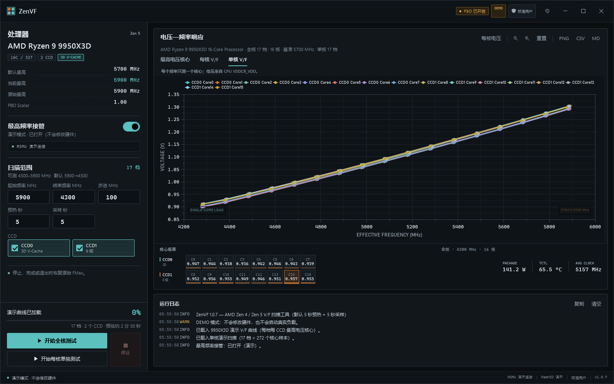
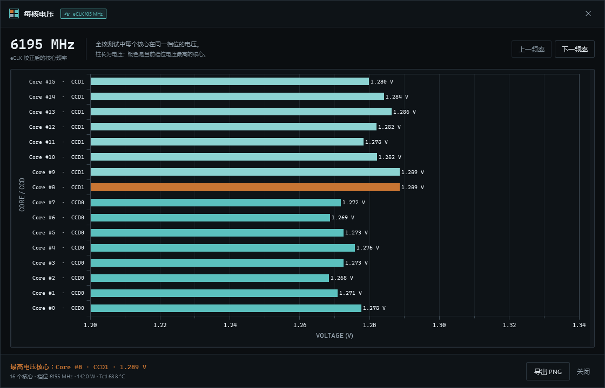
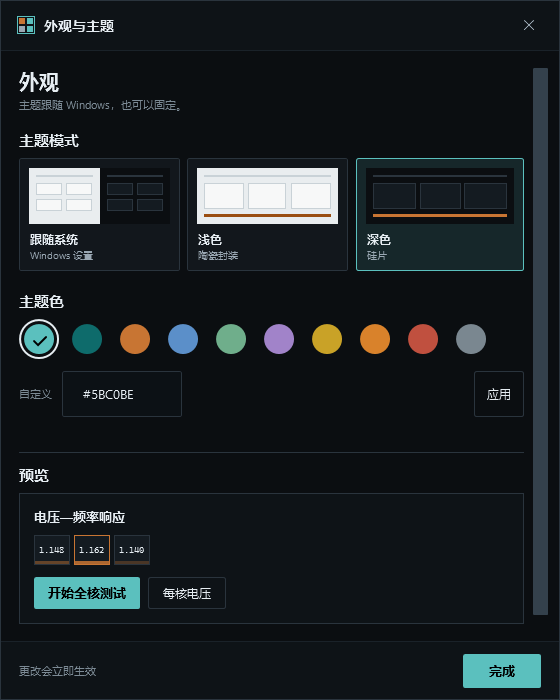

# ZenVF

ZenVF 是一个 AMD Zen 4 / Zen 5 的 PBO 频率-电压（V/F）测试工具。它会逐档设置 CPU 的最高加速频率，用内置 SSE2 负载让核心运行，再记录每个核心的实测频率和电压，最后画成 V/F 曲线。界面采用硅片地图风格：核心版图遥测带、发丝分隔和等宽读数；默认跟随 Windows 浅色/深色模式，也可以在右上角外观按钮中手动选择主题和主题色。

你可以用它：

- **全核测试**：所有核心同时负载，查看每个 CCD 的最高电压核心轨迹和每核曲线；只勾选一个 CCD 即可只测试该 CCD；
- **每核单独测试**：每次只测一个物理核心，逐核得到单核负载下的 V/F 曲线；
- **每核电压**：查看同一频率下每个核心的电压分布；
- **eCLK 实际频率**：检测异步外频后，在每核电压窗口的档位和标题中显示 `设定频率 × eCLK` 的实际频率；
- **缩放与平移**：用图表右上角的 `−` / `+` / `重置` 或鼠标滚轮缩放，按住鼠标左键拖动平移坐标图；
- **导出**：把当前图表保存为 PNG，导出完整 CSV 数据，或生成 Markdown 测试报告。

界面、扫描范围和 CSV 中的最高频率都使用**实际最高加速频率**；程序在写入 SMU 时会自动换算为对应型号的 **FMax 上限**。检测到 eCLK 时，每核电压窗口的档位和标题另显示 eCLK 实际频率，主 V/F 图横轴仍使用实测有效频率。









> ZenVF 与 AMD、SkatterBencher、PawnIO、LibreHardwareMonitor 均无隶属关系。SMU 写入有风险，请先阅读[安全说明](#安全说明)。

## 功能

- 硅片地图界面：左侧 `360 px` 条件栏使用发丝分隔而非卡片，右侧为图版式 V/F 图与核心版图遥测带；每个物理核心是一个区块，铜色条表示本档电压，最高电压核心用铜色边框标出。数字输入和所有测量值使用 Cascadia Mono 等宽字体。默认跟随 Windows 浅色/深色模式；右上角外观按钮可手动选择 System / Light / Dark 和主题色，设置保存在 `%LOCALAPPDATA%\ZenVF\theme.json`。集中设置起始/结束最高频率、步进、预热与采样时间；默认预热 `5 s`、采样 `5 s`。
- 通过 PawnIO 驱动和内置 `RyzenSMU.bin` 模块直接读写 AMD RSMU（不依赖厂商超频软件）。
- 读取当前实际最高加速频率、PBO Scalar、PPT/TDC/EDC 限制与 CPU 基础信息；读取到的原始 SMU FMax 上限会按型号换算后再显示。
- 检测 PBO 相关设置是否被修改（实际最高加速高于默认值、Scalar > 1、功耗/电流限制高于融合值）；任一条件成立时直接显示“PBO 已开启”。
- 最高频率接管开关：开启时保存原始 SMU FMax 上限，关闭、停止测试或正常退出时按原始值恢复，并回读确认。
- 默认扫描终点使用型号基准时钟：9800X3D 默认 `5425 → 4700 MHz`（PBO +200 时），而不是固定 `基准 −1000 MHz`。
- 9800X3D 的 SMU FMax 上限比实际最高加速高 `25 MHz`；该偏移不是所有型号通用，程序只对已验证的 9800X3D 应用，其他型号暂按 `0 MHz` 处理。
- 自动检测 CCD / 3D V-Cache，按所选 CCD 启动全核负载。
- 每个逻辑处理器启动一个绑定线程，使用 128-bit SSE2 算术循环模拟 Prime95 “SSE” 全核测试工况，不启用 256-bit AVX/AVX2。负载循环使用 12 条独立累加链和稳定定点递推，去掉了每轮 `Max` 钳位，减少热循环里的无效操作并提高指令级并行。
- 全核测试的每核电压优先从 SMU PM table 读取；LibreHardwareMonitor 0.9.6 的 `Core #N VID` 在 Zen 4/5 上仍套用 SVI2 的 `1.55 - VID × 0.00625` 公式，读数偏低且随负载反向变化。PM table 不可用时，程序会按 SVI3 语义还原为 `VID × 0.00625`（即 `1.55 - LHM 读数`），与 HWiNFO 的 Core VID 显示方式一致。
- 每核单独测试的电压改为读取 `CPU VDDCR_VDD` 封装核心电压（SMU PM table 的 SVI3 遥测平均值），不再使用容易偏低的 `Core #N VID`；这样更接近 HWiNFO 显示的封装 VDDCR_VDD，也能避免单核负载下 VID 与实际供电不一致。
- 采样周期内先对每个核心分别取电压/有效频率中位数，再在每个 CCD 内选择电压最高的核心，分别绘制每个 CCD 的最高电压核心 V/F 曲线；最高电压核心可以在不同频率档位之间变化，曲线上的 `#核心号` 标出该档选中的核心。
- eCLK 检测：程序启动后、用户开始任何测试之前，连续采样约 `5 秒`，读取 LHM `Core #N` 的运行时最大值（对应 HWiNFO Core Clocks 的“最大”列），除以当前 PBO 最大实际频率（默认 `5425 MHz`）得到 eCLK 比率；不使用当前瞬时值、`Core #N (Effective)` 或全核烤机期间的频率。若启动 Max 尚未记录到高于 PBO 的值，会用约 `0.8 秒` 单核唤醒刷新 Max，不写 FMax，也不是全核烤机；若 Core #N 仍为标称 P-state 值，则回退到 LHM Bus Speed / 100。检测到异步外频后，每核电压窗口的档位、标题和导出按 `实际频率 = 设定频率 × eCLK` 换算，例如 `5425 × eCLK`、`5325 × eCLK`。主 V/F 图横轴仍使用实测有效频率，避免重复缩放坐标；窗口内不再显示实时有效频率，实时频率只用于三个 V/F 坐标图。
- 核心编号统一从 0 开始（Core #0、Core #1…），与 CCD0/CCD1 以及 CSV 的 `core_id` 一致。
- V/F 区域提供“最高电压核心”、“每核 V/F”和“单核 V/F”三个标签页。“最高电压核心”图按 CCD 绘制每档最高电压核心轨迹；每核 V/F 图中每条曲线对应一个核心，图例同时标出 CCD 与核心号，横轴为实测有效频率、纵轴为电压。全核与单核 V/F 标签页都支持鼠标悬停高亮：压暗其他曲线，并用高对比度浮层显示 CCD、核心、频率和电压；点击不再打开额外的信息浮层。
- 图表支持坐标缩放和平移：右上角 `−` / `+` 以当前视图中心缩放，鼠标滚轮以指针位置为中心缩放，按住鼠标左键拖动平移，`重置` 同时恢复默认范围；缩放和平移状态只影响当前标签页。
- 每核单独测试：使用与全核测试相同的起止频率、步进、预热和采样时间；每个频率档位依次只对一个物理核心的全部 SMT 线程（通常 2 个）施加 128-bit SSE2 负载，逐核预热、采样并记录该核心的实测有效频率与 `CPU VDDCR_VDD` 封装电压。测试结束、停止或异常都会恢复原始 SMU FMax 上限。
- “单核 V/F”标签页：图表形式与“每核 V/F”完全一致，横轴为实测有效频率、纵轴为电压，每个核心一条曲线；区别只是数据来自单核负载。这样可以比较同一核心在单核与全核负载下的 V/F 差异，双 CCD 平台也能分别观察每个核心。
- “每核电压”窗口：选择任意已测试的 FMax 档位，查看全核扫描中所有核心在同一档位的电压分布，并突出显示最高电压核心。频率档位直接使用 eCLK 调整后的核心频率；窗口内不再显示实时有效频率，实时频率只在 V/F 坐标图中使用。
- 温度保护：Tctl 达到 105 °C 时中止测试并恢复 FMax。
- 进度条下方显示预计剩余时间和已用时间，随进度动态更新；未开始测试时显示当前扫描档位和预估总用时。
- 导出高分辨率图表 PNG、每核电压 PNG、CSV 原始数据和 Markdown 测试报告（PNG 导出当前选中的标签页；CSV 同时包含全核扫描、每档每核心电压和单核逐核电压记录；CSV/Markdown 的 eCLK 实际频率列会写入调整后的频率，每核电压 PNG 文件名也使用该频率；Markdown 汇总测试参数、全核最高电压核心表、每核 V/F 范围和每核单独测试结果）。

## 1.0.7 更新

- 界面按 Impeccable 的 Operate 规范重做为硅片地图：硅片/陶瓷双主题、发丝分隔、铜色电压编码、核心版图遥测带、图版式图表和等宽读数；默认跟随 Windows，右上角外观按钮可切换 System / Light / Dark 和预设/自定义主题色。
- 左侧条件栏重排为 `360 px`：处理器读数改为点线引导字段，扫描参数改为 `3×2` 输入网格，操作区固定在底部；CCD 选择改为封装区块。
- 起始/结束频率、步进、预热和采样数字输入改用 `Cascadia Mono` 等宽字体，并修正 TextBox 内容宿主的高度裁切。
- eCLK 状态图标统一为波形矢量图标，用于图表标题区和每核电压窗口。
- 单核倒计时改为“计划总时长 + 实际进度”混合估算，避免预热阶段出现异常大的剩余时间；进度条仍按实际完成量推进。
- 每核电压窗口的频率档位直接使用 eCLK 调整后的核心频率，不再显示实测有效频率；实测有效频率只保留在 V/F 坐标图中。
- eCLK 启动检测：连续采样约 `5 秒`，读取 LHM `Core #N` 的运行时最大值（HWiNFO Core Clocks 的“最大”列），除以当前 PBO 最大实际频率（默认 `5425 MHz`）；不使用当前瞬时值、`Core #N (Effective)` 或全核烤机频率；必要时用约 `0.8 秒` 单核唤醒刷新 Max；Core #N 仍为标称 P-state 值时回退到 Bus Speed / 100。
- 新增 eCLK 检测：从 `Core #N` 运行最大值与 PBO 最大实际频率估计 BCLK2，带样本数和合理范围保护；检测到后每核电压窗口显示 `设定频率 × eCLK` 的实际频率、eCLK 芯片和调整后的导出文件名。
- 主 V/F 图、每核 V/F 图和单核 V/F 图的横轴继续使用实测有效频率；eCLK 只影响每核电压窗口的档位、标题和导出，不改变图表坐标。
- 新增 `--theme light|dark|system` 和 `--accent #RRGGBB` 命令行覆盖，便于截图和兼容性排查；命令行覆盖不会写回主题设置。
- 默认预热和采样改为各 `5 s`。在 9800X3D 上对比 `5+5` 与 `10+10`，电压差约 `0.01 V`，因此默认使用更快的 `5+5`；如果曲线抖动明显，仍可手动改回 `10+10`。
- 精简界面说明和状态文字，改用“最高频率”“全核测试”“单核测试”等更直白的说法，并补充常用参数的悬停提示。
- 测试操作区重新整理：全核、每核单独两个开始按钮纵向排列，停止按钮纵向贯通两行；按钮加入图标，去掉按钮下方的计划说明，把预估时间和实时剩余时间统一放到进度条下方。
- 移除“开始单 CCD 测试”：全核测试本身只加载所勾选的 CCD，直接选择 CCD 后开始全核测试即可；需要逐核比较时使用“开始每核单独测试”。
- 右上角权限状态改为带盾牌图标的徽标：管理员为绿色，标准用户为灰色，并补充悬停说明。
- 测试进度条下方显示 `预计剩余 mm:ss · 已用 mm:ss`，随进度动态更新；开始前显示扫描档位、CCD 数量和预估总用时，结束后显示总用时。
- PBO 检测改为直接语义：当前最高频率高于默认值、PBO Scalar 大于 `1.00` 或 PPT/TDC/EDC 高于融合值时，直接显示“PBO 已开启”，不再附加“推断”字样；小幅度频率超出也不再触发警告。
- “开始单核测试”更名为“开始每核单独测试”；每核单独测试的电压改为 `CPU VDDCR_VDD` 封装遥测，不再使用 `Core #N VID`。
- 图表右上角新增 `−` / `+` / `重置` 缩放按钮，并支持鼠标滚轮缩放和按住鼠标左键拖动平移；缩放和平移只影响当前标签页，`重置` 同时恢复两者。
- 最高电压核心图移除三条黄色参考带；未加载数据时，三个图表隐藏坐标文字，只显示中文“等待测试数据”。
- 新增“导出 MD”：生成包含测试概要、全核每档最高电压核心、每核 V/F 汇总和每核单独测试汇总的 Markdown 报告。
- 优化内置 SSE2 负载：12 条独立累加链、稳定定点递推、去掉每轮 `Max` 钳位；仍保持 128-bit SSE2，不引入 AVX/AVX2。
- 版本号保持 1.0.7。

## 1.0.6 修正

- 逐核单核扫描改为加载目标物理核心的**全部 SMT 线程**（桌面 Ryzen 通常为 2 个），而不是只加载第一个逻辑处理器。LibreHardwareMonitor 的 `Core #N (Effective)` 是同一物理核心两个 SMT 线程有效频率的平均值；只加载一个线程时该读数会接近减半，导致单核 V/F 图的横轴频率异常。
- 单核日志现在显示目标的逻辑处理器、实际运行 CPU 和线程数；如果实测有效频率明显低于或高于当前档位，会输出诊断警告。
- 修正 Windows 逻辑处理器拓扑中 L3 缓存描述符的解析偏移，使 CCD / 3D V-Cache 检测更可靠。
- 版本号提升至 1.0.6。

## 1.0.5 新增

- 图表只保留悬停信息：移除 OxyPlot 默认的点击跟踪浮层，点击曲线不再显示第二份信息。
- 默认预热时间从 `3 s` 改为 `10 s`，默认采样时间从 `6 s` 改为 `10 s`。
- 新增“逐核单核扫描”：沿用完整频率扫描范围，但每个频率档位依次只对所选 CCD 的一个物理核心施加单线程 128-bit SSE2 负载，按 CCD/核心顺序逐核预热和采样，测试结束恢复原始 FMax。
- 新增“单核 V/F”标签页：与“每核 V/F”相同，横轴为实测有效频率、纵轴为电压、每个核心一条曲线；数据来自单核负载，可与全核 V/F 直接对比。
- 单核逐核电压结果加入 CSV 导出，PNG 可导出当前选中的单核 V/F 图；演示模式提供 9950X3D 的单核逐核扫描示例数据。
- 版本号提升至 1.0.5。

## 1.0.4 新增

- “最高电压核心”图改为每个 CCD 一条最高电压核心轨迹，并在每个点上标出该档的核心号，避免双 CCD 平台只显示全局最差核心。
- 新增“每核 V/F”标签页：按核心绘制完整扫描范围内的 V/F 曲线，图例标注 `CCD0 Core0`、`CCD1 Core8` 等 CCD/核心对应关系。
- 两个 V/F 标签页都支持悬停高亮：自动压暗其他曲线，并加粗当前曲线。
- 悬停信息改为跟随鼠标的高对比度浅色浮层，显示 CCD、核心号、频率与电压，解决深色背景下文字不易辨认的问题。
- 每核 V/F 图与主 V/F 图共用同一轮扫描数据；导出 PNG 时会导出当前选中的标签页。
- 演示界面和发布截图更新，版本号提升至 1.0.4。

## 1.0.3 修正

- 核心编号统一改为 0 起始（Core #0…），与 CCD 编号及 CSV 的 `core_id` 一致。
- 主 V/F 图、每核电压图、日志、传感器状态和 CSV 使用相同的 0 起始核心号。
- 清理未使用的 SMU、拓扑和 PBO 辅助代码，保留实际最高加速与 SMU 上限换算路径。

## 1.0.2 修正

- 9800X3D 默认实际最高加速修正为 `5225 MHz`，PBO +200 修正为 `5425 MHz`；界面不再把 SMU 上限 `5450 MHz` 当作实际加速显示。
- 新增按型号换算：9800X3D 写入时 `实际 + 25 MHz = SMU 上限`，读取时反向换算；其他型号暂不应用未验证偏移。
- 默认扫描终点改为型号基准时钟；9800X3D 默认 `5425 → 4700 MHz`，不再固定使用 `基准 −1000 MHz`。
- 扫描进度、日志、V/F 图、每核电压图和 CSV 同时区分实际最高加速与 SMU 上限；CSV 字段改为 `*_actual_fmax_mhz` / `*_ceiling_fmax_mhz`。
- 恢复逻辑继续保存并写回原始 SMU 上限，确保 PBO +200 的 9800X3D 能恢复到 `5450 MHz` 上限。

## 系统要求

- Windows 10 / 11 x64。
- AMD Zen 4（Raphael、Phoenix、Hawk Point 等）或 Zen 5（Granite Ridge、Strix Point 等）处理器。
- 管理员权限。
- PawnIO 驱动 2.1 或更新版本（安装包已随程序附带，可在界面中安装）。
- .NET 10 Desktop Runtime；若使用 `dist` 中的 self-contained 版本则无需单独安装。
- BIOS 中 PBO 未被锁定，且允许 SMU 调频。部分笔记本 BIOS、品牌机 BIOS 或开启了锁定选项的平台可能拒绝写入。

> 当前拓扑检测基于 Windows 单处理器组 API，建议用于不超过 64 个逻辑处理器的桌面 Ryzen。超过 64 线程的 HEDT / 服务器平台未验证。

## 快速开始

1. 运行 `ZenVF.exe`，在 UAC 提示中允许管理员权限。
2. 如果提示缺少 PawnIO，点击“安装 PawnIO”，安装完成后重启程序或电脑。
3. 确认 CPU 型号、CCD 数量和“当前最高”频率显示正常。9800X3D 默认应为 `5225 MHz`；开启 PBO +200 后应为 `5425 MHz`。
4. 程序会连续采样约 `5 秒`，读取 LHM `Core #N` 的运行时最大值（HWiNFO 最大列）并计算 eCLK；如果启动 Max 尚未记录到高频，会短暂用约 `0.8 秒` 单核唤醒刷新，不会启动全核烤机。检测结果显示在图表标题区。
5. 打开 **“最高频率接管”** 开关。程序会保存当前频率，但还不会修改它。
6. 保持默认范围即可。9800X3D 在 PBO +200 下默认是 `5425 → 4700 MHz`，步进 `100 MHz`；预热和采样默认各 `5 秒`。
7. 点击 **“开始全核测试”**。只测试某个 CCD 时，取消勾选其他 CCD 即可；想比较每个核心的单核表现，点击 **“开始每核单独测试”**。
8. 测试结束、手动停止或关闭程序时，都会自动恢复原始频率。测试中随时可以点“停止”。进度条下方会显示预计剩余时间和已用时间。
9. 右上角外观按钮可随时切换“跟随系统 / 浅色 / 深色”和主题色；更改立即生效并保存到本机。

结果可以这样看：

- **最高电压核心**：每个 CCD 在每个频率下电压最高的核心；
- **每核 V/F**：全核负载下，每个核心一条曲线；
- **单核 V/F**：单核负载下，每个核心一条曲线；
- **每核电压**：同一频率下所有核心的电压柱状图；
- **缩放与平移**：图表右上角 `−` / `+` / `重置`，滚动鼠标滚轮缩放，或按住鼠标左键拖动；
- **导出 PNG / CSV / MD**：保存当前图表、完整原始数据或 Markdown 测试报告。

默认 `5+5` 下，全核整轮测试约 2 分钟；每核单独测试还要把每个档位重复到每个核心，9800X3D 的 8 核约 13 分钟，16 核约 26 分钟。第一次使用建议只选一个 CCD、缩小范围。全核 SSE2 负载的功耗、温度会明显高于单核负载，请先确认散热余量。

## 命令行

```text
ZenVF.exe                       正常启动；非管理员时询问是否提权
ZenVF.exe --demo                演示模式，不访问硬件，载入 9950X3D 示例曲线
ZenVF.exe --demo --screenshot out.png
                                渲染演示界面、保存截图后退出
ZenVF.exe --demo --screenshot out.png --screenshot-tab 1
                                截图时切换标签页（0 = 最高电压核心，1 = 每核 V/F，2 = 单核 V/F）
ZenVF.exe --demo --screenshot-core out.png
                                打开并截图每核电压窗口
ZenVF.exe --demo --screenshot-theme out.png
                                打开并截图外观与主题窗口
ZenVF.exe --demo-eclk --screenshot-core out.png
                                演示 eCLK 已检测状态并截图每核电压窗口（仅演示）
ZenVF.exe --theme light|dark|system
                                本次启动覆盖主题模式，不写回设置
ZenVF.exe --accent "#5BC0BE"
                                本次启动覆盖主题色，不写回设置
ZenVF.exe --cpu "AMD Ryzen 9 9950X3D"
                                覆盖用于显示的 CPU 名称（主要用于兼容性排查）
ZenVF.exe --no-elevate          跳过提权重启提示（仍需管理员权限才能写入 SMU）
```

## 外观与主题

ZenVF 使用硅片地图风格：硅片/陶瓷双主题、发丝分隔、铜色电压编码和 Cascadia Mono 读数。右上角的外观按钮打开“外观与主题”窗口。

- **跟随系统**：读取 Windows 的 `AppsUseLightTheme`，约每 `1.5 s` 检查一次；Windows 切换浅色/深色时，ZenVF 自动同步。默认使用此模式。
- **浅色 / 深色**：手动固定主题，不再跟随 Windows。浅色是陶瓷封装，深色是硅片。
- **主题色**：内置氧化青、深青、铜、硅蓝、钝化绿、光刻紫、金、警示橙、故障红、石墨，也可以输入 `#RRGGBB` 自定义。主要按钮、选中状态、图表曲线和强调色会同步更新。
- **默认主题色**：未手动选择颜色时，深色模式使用 `#5BC0BE`，浅色模式使用 `#0E6B6B`；切换主题会自动改用对应的默认色。手动选择过颜色后，切换主题会保留该颜色。
- **持久化**：设置保存到 `%LOCALAPPDATA%\ZenVF\theme.json`，下次启动自动恢复。命令行 `--theme` / `--accent` 只覆盖本次启动，不写回文件。
- **实时刷新**：切换主题或主题色会立即刷新当前窗口、每核电压窗口和图表；不会影响正在进行的测试数据。

## 重要语义

### 实际最高加速频率与 SMU FMax 上限

AMD 的 SMU FMax 命令使用 25 MHz 档位，部分型号的原始上限会比 Precision Boost 实际能选到的最高频率高一个档位。9800X3D 是当前已验证的例子：

| 状态 | 实际最高加速 | SMU FMax 上限 |
| --- | ---: | ---: |
| 默认 | 5225 MHz | 5250 MHz |
| PBO +200 | 5425 MHz | 5450 MHz |

因此，某些工具显示 `5450 MHz` 时，报告的是 **FMax 上限**，不是实际能达到的最高加速频率；9800X3D 的实际最高加速是 `5425 MHz`。这 `25 MHz` 不是计算误差，而是 SMU 上限与实际可用档位之间的差值。

ZenVF 的规则：

- 界面、扫描起始/结束输入、日志中的“实际最高加速”、V/F 图、每核电压图和 CSV 的 `*_actual_fmax_mhz` 字段都使用实际最高加速频率。
- 写入 SMU 时使用 `FMax 上限 = 实际最高加速 + 型号偏移`；9800X3D 的偏移为 `25 MHz`。
- 读取 SMU 时使用 `实际最高加速 = FMax 上限 − 型号偏移`；其他型号的偏移暂为 `0 MHz`，因为尚未验证。
- 接管和恢复保存的是原始 **SMU FMax 上限**，以保证恢复值和接管前完全一致。
- CSV 同时保留 `requested_ceiling_fmax_mhz` / `effective_ceiling_fmax_mhz`，方便与 SMU 原始读数对照。

> 目前只有 9800X3D 的 `5225 / 5250` 与 `5425 / 5450` 语义经过确认。其他型号的默认最高加速、基准时钟和 25 MHz 偏移没有真机测试覆盖。
>
> 公开资料中的型号数据也说明这不是所有 CPU 的通用规则：7800X3D 报告的 FMax 为 `5050 MHz`，与其最高频率一致；9950X3D 的两个 CCD 分别报告 `5550 / 5750 MHz` 上限。因此程序不会对其他型号统一加 `25 MHz`，避免把未验证的偏移写进 SMU。

### “PBO 已开启”来自 SMU 可见设置

程序没有读取 BIOS 的 PBO 开关，而是检测以下 SMU 可见特征：

- 当前实际最高加速是否高于该型号的默认实际最高加速；
- PBO Scalar 是否大于 `1.00`；
- PPT / TDC / EDC 限制是否高于熔断（fused）限制。

只要任一条件成立，界面就直接显示“PBO 已开启”，不再附加“推断”字样。PBO 处于 Auto、但没有修改任何可见限制时，可能显示“未检测到”；这不等于 BIOS 中的 PBO 一定关闭。

小幅度频率超出是正常的 Boost 行为，不会触发“SMU FMax 未生效”警告；只有实测频率明显高于当前档位时才会提示。FMax 回读也允许 `50 MHz` 的小偏差。

### “最高频率接管”不是 BIOS PBO 开关

接管开关只授予程序写入 FMax 的权限：

- 开启：读取并保存当前原始 SMU FMax 上限；测试开始时写入“实际起始 + 型号偏移”的上限。
- 关闭：立即把保存的原始 SMU FMax 上限写回。
- 测试结束/停止/异常/正常退出：自动恢复原始 SMU FMax 上限，并回读校验。

它不会修改 BIOS 中的 PBO 模式、Curve Optimizer 或其他设置。恢复使用原始上限而不是界面显示的实际值，因此 PBO +200 的 9800X3D 会恢复为 `5450 MHz` 上限，对应实际 `5425 MHz`。

### 负载是内置 SSE2，不是外部 Prime95.exe

全核扫描会为所选 CCD 的每个逻辑处理器启动一个绑定的 128-bit SSE2 算术循环，目标是复现 Prime95 的 “SSE” 全核测试工况：所有核心同时高负载，但不使用 256-bit AVX/AVX2，以减少 AVX 负载导致的降频和额外功耗。逐核单核扫描复用同一 SSE2 负载，但每个频率档位只为当前目标物理核心启动负载线程：该核心的每个 SMT 线程一个线程（通常共 2 个），分别绑定到对应的逻辑处理器；一个核心采样完成后才切换到下一个核心，同一档位内所有核心使用相同的 FMax 上限。这样物理核心的两个 SMT 线程都处于满载状态，LHM 的平均有效频率也能反映真实核心频率。它不是调用系统里的 `prime95.exe`，也不依赖 Prime95 的配置文件。若需要严格的 Prime95 可重复性，后续可以增加“外部 Prime95 路径”选项。

SSE2 热循环使用 12 条独立累加链，递推式为 `v = v × factor + bias`，定点在 `1.0`，因此不需要每轮 `Max` 钳位，也不会漂移到无穷大；两条链额外做 `sqrt` 增加浮点延迟。这样比原来的 8 条链 + 每轮 `Max` 有更好的指令级并行，同时保持 128-bit SSE2 的负载性质。

### 主 V/F 图按 CCD 使用最高电压核心

每个 FMax 档位会先对每个核心的电压和有效频率取中位数，然后在每个 CCD 内分别选择电压最高的核心，作为该 CCD 主 V/F 曲线的一个点。因此双 CCD 平台会看到两条轨迹（如 9950X3D 的 CCD0/CCD1），而不是只显示全局最差核心；最高电压核心可以在不同频率档位之间变化，也可以在 CCD 内变化。图上的 `#核心号` 标注每一档选中的核心，鼠标悬停浮层会显示该点的 CCD 和核心号，并压暗其他 CCD 的曲线与标注。“每核 V/F”标签页则把每个核心在所有档位上的点连成独立曲线，悬停同样会压暗其他核心。CSV 的 `per_core_voltages` 段保留每档全部核心数据，`core_id` 与界面一样从 0 开始。

### 图表横轴是实测有效频率

主 V/F 图、每核 V/F 图和单核 V/F 图的 X 轴使用被选中核心在扫描期间实测的中位有效频率，而不是写入 SMU 的 FMax 设定值。这样曲线反映散热、电压和功耗共同作用后的真实频率；CSV 中同时保留实际最高加速（`requested_actual_fmax_mhz`、`effective_actual_fmax_mhz`）、SMU 上限（`requested_ceiling_fmax_mhz`、`effective_ceiling_fmax_mhz`）和实测有效频率（`effective_clock_mhz`）。FMax 是 Precision Boost 的上限，不是固定倍频；全核或单核负载下实际频率都可能低于设定值。

eCLK 只改变每核电压窗口的档位和标题，不会把已经实测的有效频率再次乘以 eCLK；因此三个 V/F 图的坐标始终是 LHM 实际读数。

### eCLK 检测与实际频率

在 AM5 主板上启用异步外频（eCLK）时，核心时钟由 BCLK2 驱动，而 SMU 仍以标称 `100 MHz` 为基准。ZenVF 使用 HWiNFO `Core Clocks` 的“最大”列语义，对应 LHM `Core #N` 传感器的运行时 `Max` 值：

- `Core #N` 的运行时最大值：HWiNFO 图 2 第三列的最大频率，本算法使用的频率来源；
- `Core #N` 的当前瞬时值：不参与 eCLK 计算；
- `Core #N (Effective)`：不参与 eCLK 计算，只继续用于三个 V/F 坐标图；
- PBO 最大实际频率：当前 SMU 上限换算出的实际最高加速，例如 PBO +200 的 `5425 MHz`。

启动后、用户开始任何测试之前，连续采样约 `5 秒`，读取所有核心 `Core #N` 的运行时最大值，取其中最高的一个，除以 PBO 最大实际频率。延长采样是为了让 Bus Speed 和运行时 Max 收敛，而不是取决于第一次 50 ms 读数。LHM 的 Max 需要至少一个高频采样才能建立；如果启动阶段 Max 还没有超过 PBO 上限，会用一个约 `0.8 秒` 的单核唤醒刷新 Max，然后重新读取。这个唤醒不是全核烤机，也不写入 FMax；eCLK 只使用 `Core #N` 的 Max 值，不使用唤醒过程中的瞬时值或 `Effective`。

如果 LHM 的 `Core #N` 在 eCLK 下仍停留在标称 P-state 值，则读取 LHM 的 `Bus Speed`，用 `Bus Speed / 100` 作为回退比率；这仍然是显示频率/总线频率，不使用 `Effective`。

- **公式**：`eCLK = 最高 Core #N 运行时最大值 / 当前 PBO 最大实际频率`；例如 HWiNFO 最大列 `5625.2 MHz`、PBO `5425 MHz` 时，`5625.2 / 5425 ≈ 1.03690`，即 eCLK ≈ `103.690 MHz`。如果使用 Bus Speed 回退，则 `103.69 / 100 ≈ 1.03690`。
- **取最大值**：启动采样 5 秒，`Core #N` 取运行最大值，Bus Speed 也取最大值；档位频率按乘积四舍五入到最近的 MHz，避免总线抖动让结果掉 1 MHz。
- **BCLK 两位小数**：BIOS 的 eCLK/BCLK2 只支持两位小数；计算出的第三位只要有值就向第二位进一位（不是四舍五入）。例如 `103.688` 和 `103.689` 都记为 `103.69`，避免向下取整造成偏低。
- **有效样本**：至少有一个 `Core #N` 运行时最大值 ≥ `800 MHz`；当前值和 `Effective` 读数不作为最大频率来源。
- **合理范围**：比率必须 ≥ `1.0025`，上限 `1.350`；低于下限视为未检测到 eCLK。
- **不做防抖**：不取百分位、不取中位数、不做多档一致性检查；直接使用 `Core #N` 的运行最大值。
- **显示时机**：启动读取完成后立即在图表标题区显示 eCLK，不等待正式烤机测试。
- **显示行为**：检测到 eCLK 后，每核电压窗口的标题、档位频率、eCLK 芯片和每核电压 PNG 文件名使用调整后的实际频率；CSV 的 `eclk_actual_fmax_mhz` 列和 Markdown 的“eCLK 实际 (MHz)”列会写入调整后的频率，未检测时该列等于设定频率。
- **未检测时**：每核电压窗口的标题按普通设定频率显示，图表和导出仍保留实测有效频率。

> eCLK 在程序启动时读取一次；如果在运行中修改 BIOS 的 eCLK/BCLK2，需要重启 ZenVF 重新检测。当前实现针对 AM5 异步 eCLK（BCLK2）场景；启动阶段若 LHM 没有提供 `Core #N` 的 Max 值或 Bus Speed，程序不会猜测 eCLK；同步 BCLK 超频或 LHM 不提供这些传感器时也会按未检测处理。

### 图表缩放、平移与 Markdown 报告

三个 V/F 标签页的坐标轴都允许缩放和平移。`−` / `+` 以当前视图中心按固定倍率缩放，`重置` 恢复默认坐标范围；鼠标滚轮以指针位置为中心缩放，按住鼠标左键拖动可平移视图。缩放和平移状态保存在各自的图表模型中，切换标签页不会丢失；重新运行测试或重建图表时恢复默认范围。未加载数据时，图表隐藏坐标文字，只显示“等待测试数据”。

“导出 MD”会生成 UTF-8 Markdown 报告，内容包括测试参数、FMax 语义、全核每档最高电压核心表、全核每核 V/F 范围，以及每核单独测试的每档汇总和每核 V/F 范围。逐点原始数据仍建议导出 CSV；Markdown 中的每核单独电压统一标注为 `CPU VDDCR_VDD` 封装遥测。

### 单核 V/F 图使用与每核 V/F 相同的坐标

“单核 V/F”图与“每核 V/F”图使用完全相同的坐标语义：X 轴为实测有效频率，Y 轴为电压，每个核心一条曲线，图例标注 `CCD0 Core0`、`CCD1 Core8` 等。区别只在测试方式：全核图的所有核心同时加载，单核图的每个频率档位只加载一个物理核心。

因此，同一核心在两张图中的电压可以不同：单核负载下其他核心空闲，封装功耗、漏电和供电负载都更低，电压通常会低于全核负载；具体差异取决于 CPU 体质、散热和主板供电。逐核单核扫描仍然使用与全核扫描相同的起止频率、步进、预热和采样设置，并按照 CCD/核心顺序在每个档位内依次测试所有所选核心。每核单独测试的 Y 轴电压来自 `CPU VDDCR_VDD` 封装遥测，而不是每个核心各自的 `Core #N VID`；同一档位内不同核心会共享当时的封装电压，因此曲线之间的差异主要来自实测有效频率，而不再混入 VID 的读数偏差。CSV 的 `single_core_per_core_voltages` 段保留频率、核心、首个逻辑处理器、实测有效频率、电压、温度、封装功耗和采样数；停止或结束时同样恢复原始 FMax。

### 扫描方向与默认范围

起始实际最高加速必须不小于结束实际最高加速，扫描按步进从高到低进行。每个点之间会重新写入对应的 SMU FMax 上限，并等待预热时间。

默认值会读取当前实际最高加速作为起点，并使用型号基准时钟作为终点；没有基准时钟数据时回退到 `默认最高加速 − 500 MHz`。9800X3D 在 PBO +200 下默认是 `5425 → 4700 MHz`、步进 `100 MHz`，实际会覆盖 `5425, 5325, …, 4725, 4700`（共 9 点）。默认预热/采样为 `5+5 秒`；如果曲线抖动明显，改成 `10+10 秒`。

### 倒计时估算

全核测试按 `档位数 × (预热 + 采样)` 估算计划总时长；每核单独测试按 `档位数 × 物理核心数 × (预热 + 采样 + 固定开销)` 估算。测试开始后，倒计时以计划总时长为基线，并随进度逐步混入实测速度 `已用时间 / 当前进度`，这样预热阶段不会出现异常大的剩余时间，运行较慢或较快时也能逐渐校正。进度条本身仍按已完成的档位/核心和当前阶段推进。

## 安全说明

- SMU 写入会立即改变 CPU 的加速上限。请确保散热器安装正常、风扇曲线可用，并在测试期间观察温度。
- 不要长时间运行超过散热能力的 FMax。程序默认把起始实际最高加速限制在“默认实际最高加速 +200 MHz”以内（9800X3D 为 `5425 MHz`，对应 SMU 上限 `5450 MHz`），但这不是安全保证。
- 若程序被强制结束、系统崩溃或断电，FMax 可能保持最后写入值直到重启。遇到异常退出后请重启系统，再重新运行。
- 笔记本/APU 的 SMU 命令与桌面不同，程序会尝试 APU 命令集，但此类平台风险更高且未验证。
- 不要同时运行 Ryzen Master、HWiNFO 的写入功能或其他 SMU 调频工具。

## 构建

需要 .NET SDK 10 和 Windows：

```powershell
dotnet build .\src\ZenVF\ZenVF.csproj -c Debug
dotnet run --project .\src\ZenVF\ZenVF.csproj -- --demo
```

发布 self-contained x64 版本：

```powershell
.\publish.ps1
```

发布 framework-dependent 版本：

```powershell
.\publish.ps1 -FrameworkDependent
```

输出位于 `dist\`。脚本会一并复制 README、第三方声明和许可证文本。

## 项目结构

```text
src/ZenVF/
  App.xaml(.cs)             启动、提权、异常日志、主题初始化
  MainWindow.xaml(.cs)      主界面、导出、关闭恢复
  CoreVoltageWindow.xaml(.cs) 每核电压窗口与 PNG 导出
  ThemeSettingsWindow.xaml(.cs) 外观与主题设置窗口
  Interop/
    PawnIoNative.cs         PawnIO 设备与 IOCTL 封装
    SmuController.cs        RSMU FMax/Scalar/融合限制读写
  Models/                   CPU、拓扑、扫描参数、应用选项与结果模型
  Services/
    LoadGenerator.cs        全核 / 单核 128-bit SSE2 负载与线程绑定
    LhmSensorService.cs     LibreHardwareMonitor 传感器与每核 CCD 映射
    SweepEngine.cs          全核、逐核单核扫描、采样、温度保护、恢复
    EclkDetector.cs         启动 Core #N 运行时最大值 / PBO 最大频率的 eCLK 比率
    ChartBuilder.cs         OxyPlot 主/每核/单核 V/F、每核电压柱状图与导出
    DemoData.cs             演示数据（16 核，含全核与单核逐核示例）
    ThemeManager.cs         主题/主题色、系统跟随与持久化
  Themes/
    Fluent.xaml             共用控件样式与硅片地图设计系统
    Dark.xaml               深色调色板
    Light.xaml              浅色调色板
licenses/                   第三方许可证全文
```

## 验证状态

- UI、演示曲线、PBO 接管开关、全核/每核单独开始按钮、开始/停止、动态剩余时间、每 CCD 最高电压核心轨迹、每核 V/F 标签页、单核 V/F 演示、悬停高亮与高对比度浮层、点击不再显示跟踪信息、每核电压窗口、图表按钮/滚轮缩放、鼠标拖动平移、空图表“等待测试数据”、CSV/PNG/Markdown 导出和发布流程已验证。
- `360 px` 条件栏、Cascadia Mono 数字输入、eCLK 波形图标、单核倒计时和每核电压档位调整已通过演示截图与反射逻辑检查；`5425→4700 MHz` 档位、每核单独测试 8 核计划时长、启动 `Core #N` 运行时最大值、`Effective` 不参与判定和导出列均有断言覆盖。
- 硅片地图浅色/深色主题、默认主题色随主题切换、主题色预设/自定义、设置持久化、实时刷新、eCLK 演示状态及每核电压档位/导出已验证；真实 eCLK 检测、BCLK2 与 HWiNFO 的频率对照仍待管理员权限真机确认。
- 9800X3D 管理员权限下已基本验证全核/单核测试：单核频率读数已正常，`5+5` 与 `10+10` 的电压差约 `0.01 V`。每核单独测试改用 `CPU VDDCR_VDD` 后的绝对电压仍需在真机上与 HWiNFO 做一次对照；更长时间的稳定性、异常退出恢复和双 CCD 平台仍建议自行确认。
- 非管理员路径已在 9800X3D 上验证拓扑识别为 1 个 CCD / 8 个物理核心 / 16 个逻辑处理器，并确认目标核心的两个 SMT 线程分别绑定到对应 CPU。
- CPUID、Zen 5 架构识别、9800X3D 默认最高加速、单 CCD 拓扑和 PawnIO 安装检测已在 Ryzen 7 9800X3D 真机上验证。
- 9800X3D 的频率语义已确认：默认实际最高加速 `5225 MHz` / SMU 上限 `5250 MHz`；PBO +200 实际最高加速 `5425 MHz` / SMU 上限 `5450 MHz`。程序据此对 9800X3D 应用 `25 MHz` 上限偏移。
- 当前开发会话仍为标准用户权限，自动化验证不能读取真实 SMU/传感器；上述 9800X3D 结论来自用户实测。
- 除 9800X3D 外，其他型号的默认实际最高加速、基准时钟、SMU 上限偏移和恢复行为没有真机测试覆盖；程序对未知或未验证型号使用 `0 MHz` 偏移和保守的回退默认值。
- 全核测试的每核电压优先读取 SMU PM table，当前支持 Granite Ridge 的 `0x00621202`、`0x00621201` 和 `0x00620205`（`0x994` 表，每核电压起始索引 `317`）。`0x00620205` 是 9800X3D 在当前 AGESA 下报告的版本；其布局按 `0x00621202` 处理，并用 SVI3 封装电压做合理性校验。校验失败或 PM table 不可用时，回退到经过 SVI3 修正的 LHM `Core #N VID`。
- 每核单独测试的电压读取同一 PM table 的索引 `19`（SVI3 `VDDCR_VDD` 遥测平均），索引 `49`（Vcore P1）作为旧表回退；这与 HWiNFO 的 `CPU VDDCR_VDD Voltage` 语义对应。该映射目前只对 Granite Ridge 的已支持表版本启用，其他型号或读取失败时会在日志中明确提示并回退到 `Core #N VID`。
- 首次在真机使用时，建议以管理员身份先只读确认：当前实际最高加速为 `5425 MHz`（PBO +200）、原始 SMU 上限为 `5450 MHz`，且所有核心都能在负载下报告 Effective Clock 和电压。随后用一个 CCD、较短时间执行 `5425 → 4700 MHz` 扫描，确认日志中每档“实际 / 上限”对应、回读正常、停止后恢复为 `5450 MHz` 上限，并与 HWiNFO 的 Effective Clock / Core Voltage 对照。

## 第三方组件

详见 [THIRD-PARTY-NOTICES.md](THIRD-PARTY-NOTICES.md)。主要组件：

- LibreHardwareMonitorLib 0.9.6 — MPL-2.0
- OxyPlot.Wpf 2.2.0 — MIT
- PawnIO 2.1 — GPL-2.0（含设备 IOCTL 链接例外）
- RyzenSMU.bin（PawnIO 模块，来自 LibreHardwareMonitor）— LGPL-2.1
