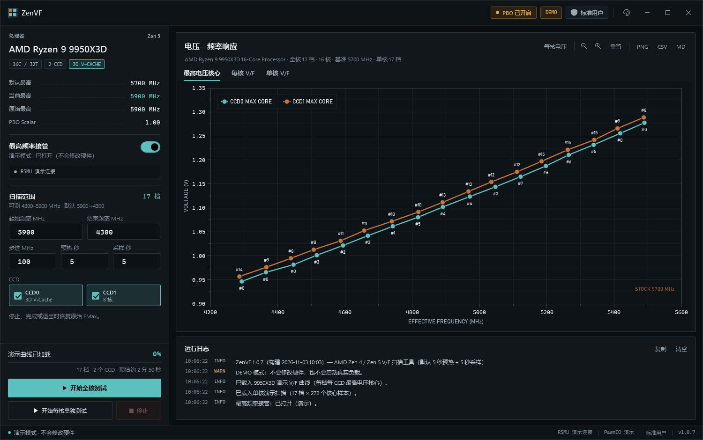
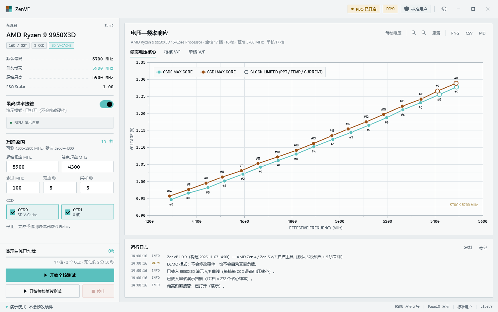
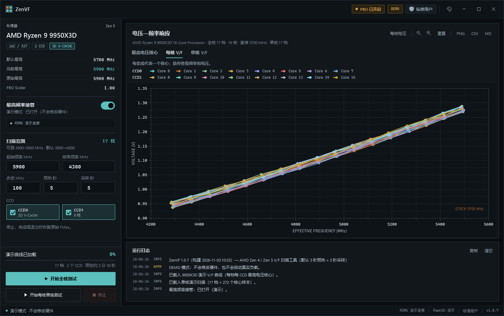
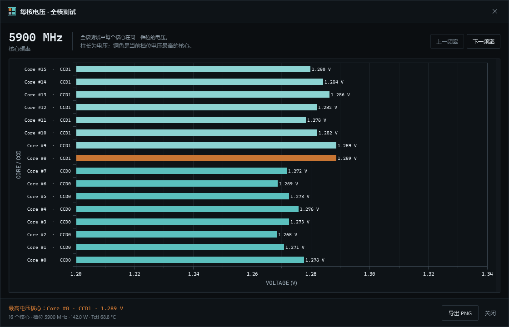

# ZenVF

ZenVF 是 AMD Zen 4 / Zen 5 的 PBO 频率-电压（V/F）测试工具。它逐档设置 CPU 的最高加速频率，用内置 SSE2 负载让核心满载，记录每个核心的实测频率和电压，并绘制 V/F 曲线。

| 深色 | 浅色 |
| --- | --- |
|  |  |

## 功能

- **全核测试**：所选 CCD 同时满载，逐档记录每个核心的电压，并绘制每个 CCD 的最高电压核心曲线。
- **每核单独测试**：每次只给一个物理核心满载，得到单核 V/F 曲线。
- **三个图表页**：最高电压核心、每核 V/F、单核 V/F。每核图里每个核心一种颜色，图例按 CCD 分行。支持悬停查看数值、滚轮缩放、拖动平移。
- **每核电压窗口**：查看同一频率档位下所有核心的电压分布。在"单核 V/F"页打开时优先显示每核单独测试的结果，其他页优先显示全核测试的结果；只做过其中一种测试时，任何页都显示那一种的结果，窗口标题会注明是哪一种。
- **导出**：PNG、CSV 和 Markdown 报告。

## 界面

左侧是 CPU 信息、测试条件和开始/停止按钮，右侧上方是 V/F 图表，下方是运行日志。

| 每核 V/F | 每核电压 |
| --- | --- |
|  |  |

## 测量方式

### 电压来源

电压直接读取 CPU 内部 SMU 的 PM table，与 HWiNFO 读的是同一个数：

| ZenVF 中的数据 | PM table 位置 | 对应 HWiNFO 的项 |
| --- | --- | --- |
| 全核测试：最高电压核心、每核 V/F、每核电压窗口 | 第 317 + N 项 | `Core N VID` |
| 每核单独测试：单核 V/F | 第 49 项 | `CPU VDDCR_VDD Voltage (SVI3 TFN)` |

以上对应关系已在 Ryzen 7 9800X3D（PM table 版本 `0x00620205`）上实测：不刷新 PM table 时读到的值与 HWiNFO 逐位一致。版本 `0x00621201` / `0x00621202` 按相同布局推定，未实测。

如果 PM table 不可用（例如 Ryzen 7000 系列，或 BIOS 更新后版本号变化），程序会退回 LibreHardwareMonitor 的 Core VID，此时结果和 HWiNFO 对不上，启动日志会给出警告。

### 每档数值怎么算

- **电压**：取每档采样期间（不含预热）的**平均值**。
- **频率、温度**：取采样期间的中位数。频率来自 LibreHardwareMonitor 的有效频率（Effective Clock）。
- **电压源锁定**：同一档只使用一种电压源；采样中途发生切换时，日志会标出各来源的次数和最终采用的来源。
- **频率受限标记**：全核测试中，如果实测频率比档位低 100 MHz 以上，说明该档受 PPT 功耗、温度或电流限制，曲线这一段反映的是限制墙，而不是 V/F 特性。这些档位在"最高电压核心"图上显示为空心圆环，悬停时会注明；日志、CSV（`clock_limited` 列）和 Markdown 报告（"备注"列）中也会标出。
- **电压来源记录**：CSV 的 `voltage_source` 列和 Markdown 报告记录了每档实际使用的电压源。


## 支持的处理器

只有已识别的型号会收到 SMU 命令，其他处理器只能查看传感器读数：

| 平台 | 家族 / 型号 | 例子 |
| --- | --- | --- |
| Raphael / Dragon Range | 19h / 61h | Ryzen 7000 桌面版、7045 系列移动版 |
| Phoenix / Phoenix 2 / Hawk Point | 19h / 74h、78h、75h | Ryzen 8000G、7040/8040 移动版 |
| Granite Ridge（含 Fire Range） | 1Ah / 44h | Ryzen 9000 桌面版、9955HX |
| Strix Point / Krackan Point | 1Ah / 24h、60h | Ryzen AI 300 |
| Shimada Peak | 1Ah / 08h | Threadripper 9000（命令组未实测） |

- 型号在内置表中时，起始频率最高允许"默认最高频率 + 200 MHz"。
- 型号不在表中时，起始频率不能超过写入前读到的当前最高频率。
- Zen 3、Strix Halo、Threadripper 7000 等未列出的平台不支持写入。

## 系统要求

- Windows 10/11 x64
- 上表中的 AMD Zen 4 / Zen 5 处理器
- 管理员权限
- PawnIO 驱动（首次运行可从界面安装）
- .NET 10 Desktop Runtime；使用 `dist` 自包含发布包时不需要单独安装

## 快速开始

1. 运行 `ZenVF.exe`，允许管理员权限。启动日志第一行会显示构建时间，可据此确认运行的版本。
2. 选择 CCD，填写起始/结束频率、步进、预热和采样时间。默认预热 `5 s`、采样 `5 s`。
3. 打开"最高频率接管"。
4. 点"开始全核测试"或"开始每核单独测试"。
5. 测试结束、停止或退出程序时会恢复原始 FMax。

## 命令行

```text
ZenVF.exe                       正常启动
ZenVF.exe --demo                演示模式，不访问硬件
ZenVF.exe --demo-eclk           演示 eCLK 已检测状态
ZenVF.exe --theme system|light|dark
ZenVF.exe --accent "#5BC0BE"
ZenVF.exe --no-elevate          跳过提权重启提示
ZenVF.exe --demo --screenshot out.png
ZenVF.exe --demo --screenshot out.png --screenshot-tab 0|1|2
ZenVF.exe --demo --screenshot-core out.png [--screenshot-tab 2]   每核电压窗口（加 2 为每核单独测试）
ZenVF.exe --demo --screenshot-theme out.png
```

`--theme` / `--accent` 只覆盖本次启动，不写回设置。

## 重要说明

- 界面和 CSV 使用实际最高加速频率；写入 SMU 时自动换算为 FMax 上限。9800X3D 的已验证偏移是 `+25 MHz`。
- "PBO 已开启"依据 SMU 可见设置判断：实际最高加速高于默认值、Scalar > 1.00，或 PPT/TDC/EDC 高于融合值。
- 主 V/F 图横轴是实测有效频率；eCLK 只影响每核电压窗口、标题和导出的频率标签。
- 负载是内置 128-bit SSE2 循环，不启动外部 Prime95.exe，也不使用 AVX/AVX2。
- 每核单独测试的电压是整颗 CPU 共用的 VDDCR_VDD 供电电压，不是单个核心的 VID；同一档内各核心共享该电压。

## 常见问题

**启动日志显示"SMU 初始化失败"**
- 读取 FMax 和 PM table 前要先获得 PCI 总线锁，HWiNFO（启动或退出时）、MSI Center 等监控软件可能会占用它几秒。ZenVF 启动时最多尝试 3 次（每次间隔 1 秒），仍失败时会说明原因。
- 日志提示"PCI 总线锁一直被其他硬件监控程序占用"时，稍等片刻后点 SMU 状态行右侧的"重新连接"即可，不需要重启。
- 只有提示"返回的 FMax 无效"时，才可能是 BIOS 锁定了 PBO 设置。


## 安全说明

SMU 写入有风险，请确认散热和供电余量后再测试。程序会在停止、完成、异常退出、注销/关机或温度保护触发时尝试恢复原始 FMax；如果仍未恢复，重启电脑即可。不要强制结束正在写入 SMU 的进程。

ZenVF 与 AMD、PawnIO、LibreHardwareMonitor、OxyPlot、HWiNFO 均无隶属关系。

## 构建

需要 .NET 10 SDK：

```powershell
dotnet build src/ZenVF/ZenVF.csproj -c Release
dotnet test tests/ZenVF.Tests/ZenVF.Tests.csproj -c Release
.\publish.ps1
```

`dotnet test` 运行单元测试，不需要硬件、管理员权限或 PawnIO，覆盖：FMax 恢复规则、型号识别与平台支持、扫描参数校验、电压源选择、温度保护、负载线程计数、eCLK 判断，以及 CSV / Markdown 导出格式。

输出目录：`dist\`。`publish.ps1` 默认生成 `win-x64` 自包含包；加 `-FrameworkDependent` 可生成依赖框架的版本。`publish.ps1` 会先清空 `dist\`，打包前请先关闭正在运行的 ZenVF。

## 第三方组件

PawnIO、LibreHardwareMonitor、OxyPlot 及授权文本见 [THIRD-PARTY-NOTICES.md](THIRD-PARTY-NOTICES.md) 和 `licenses/`。
