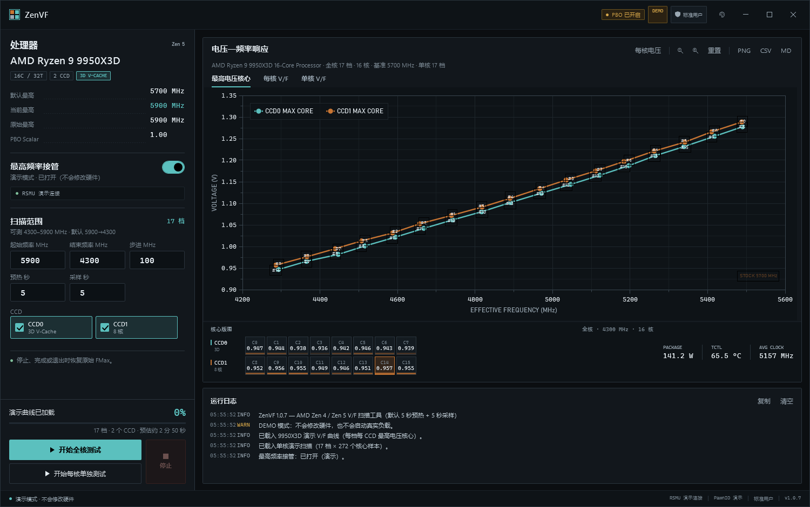
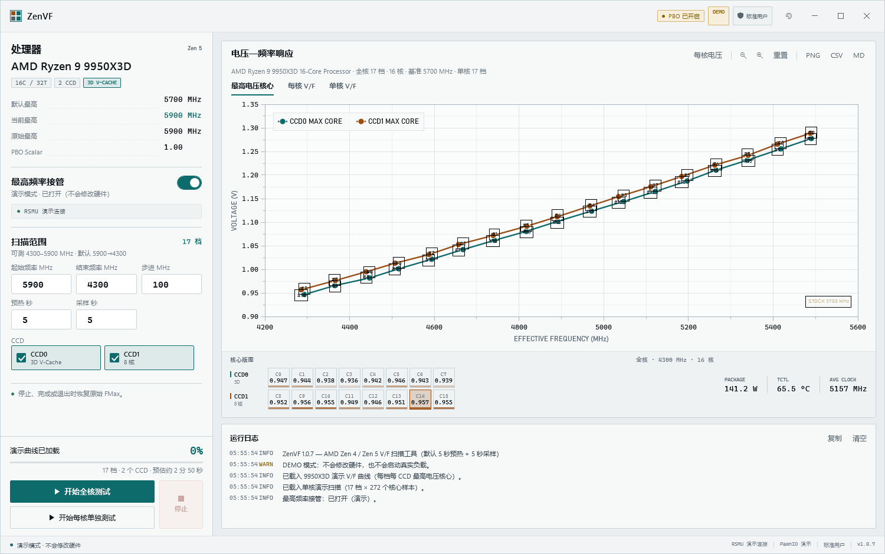
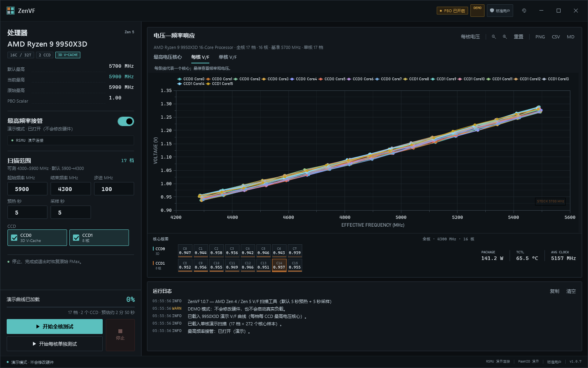
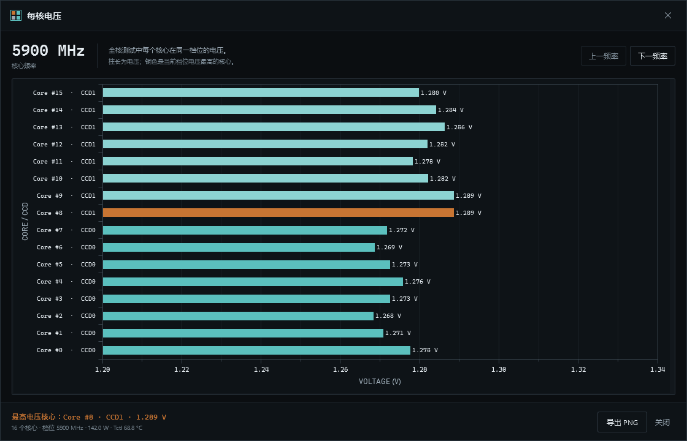

# ZenVF

ZenVF 是 AMD Zen 4 / Zen 5 的 PBO 频率-电压（V/F）测试工具。它逐档设置 CPU 的最高加速频率，用内置 SSE2 负载让核心运行，记录每个核心的实测频率和电压，并绘制 V/F 曲线。界面采用硅片地图风格，默认跟随 Windows 浅色/深色模式。

| 深色 | 浅色 |
| --- | --- |
|  |  |

## 功能

- 全核测试：所选 CCD 同时负载，绘制每个 CCD 的最高电压核心轨迹。
- 每核单独测试：每次只测一个物理核心，得到单核 V/F 曲线。
- 每核电压：查看同一频率档位下所有核心的电压分布。
- 三个图表页：最高电压核心、每核 V/F、单核 V/F；支持悬停、滚轮缩放、拖动平移。
- eCLK 检测：检测异步外频，并在每核电压窗口和导出中显示调整后的频率。
- 导出 PNG、CSV 和 Markdown 报告。
- 最高频率接管：测试结束、停止或退出时恢复原始 FMax；Tctl 达到 105 °C 时中止。
- 主题跟随系统/手动切换，支持预设和自定义主题色。

## 界面

左侧是测试条件，右侧是图表和核心版图遥测带。每个物理核心是一个区块，铜色条表示该档电压，最高电压核心用铜色边框标出。

| 每核 V/F | 每核电压 |
| --- | --- |
|  |  |

## 系统要求

- Windows 10/11 x64
- AMD Zen 4 / Zen 5
- 管理员权限
- PawnIO 驱动（首次运行可从界面安装）
- .NET 10 Desktop Runtime；使用 `dist` 自包含发布包时不需要单独安装

## 快速开始

1. 运行 `ZenVF.exe`，允许管理员权限。
2. 选择 CCD，填写起始/结束频率、步进、预热和采样时间。默认预热 `5 s`、采样 `5 s`。
3. 打开“最高频率接管”。
4. 点“开始全核测试”或“开始每核单独测试”。
5. 测试结束、停止或退出程序时会恢复原始 FMax。

首次使用建议只选一个 CCD，并缩小频率范围。9800X3D 在 PBO +200 时的默认范围是 `5425 → 4700 MHz`。

## 命令行

```text
ZenVF.exe                       正常启动
ZenVF.exe --demo                演示模式，不访问硬件
ZenVF.exe --demo-eclk           演示 eCLK 已检测状态
ZenVF.exe --theme system|light|dark
ZenVF.exe --accent "#5BC0BE"
ZenVF.exe --no-elevate          跳过提权重启提示
ZenVF.exe --demo --screenshot out.png
ZenVF.exe --demo --screenshot out.png --screenshot-tab 0|1|2
ZenVF.exe --demo --screenshot-core out.png
ZenVF.exe --demo --screenshot-theme out.png
```

`--theme` / `--accent` 只覆盖本次启动，不写回设置。

## 重要说明

- 界面和 CSV 使用实际最高加速频率；写入 SMU 时自动换算为 FMax 上限。9800X3D 的已验证偏移是 `+25 MHz`。
- “PBO 已开启”依据 SMU 可见设置：实际最高加速高于默认值、Scalar > 1.00，或 PPT/TDC/EDC 高于融合值。
- 主 V/F 图横轴是实测有效频率；eCLK 只影响每核电压窗口、标题和导出的频率标签。
- 负载是内置 128-bit SSE2 循环，不启动外部 Prime95.exe，也不使用 AVX/AVX2。

## 安全说明

SMU 写入有风险，请确认散热和供电余量后再测试。程序会在停止、完成、异常退出或 Tctl 达到 105 °C 时尝试恢复原始 FMax；如果异常退出，重启电脑即可恢复。不要强制结束正在写入 SMU 的进程。

ZenVF 与 AMD、PawnIO、LibreHardwareMonitor、OxyPlot 均无隶属关系。

## 构建

需要 .NET 10 SDK：

```powershell
dotnet build src/ZenVF/ZenVF.csproj -c Release
.\publish.ps1
```

输出目录：`dist\`。`publish.ps1` 默认生成 `win-x64` 自包含包；加 `-FrameworkDependent` 可生成依赖框架的版本。

## 第三方组件

PawnIO、LibreHardwareMonitor、OxyPlot 及授权文本见 [THIRD-PARTY-NOTICES.md](THIRD-PARTY-NOTICES.md) 和 `licenses/`。
